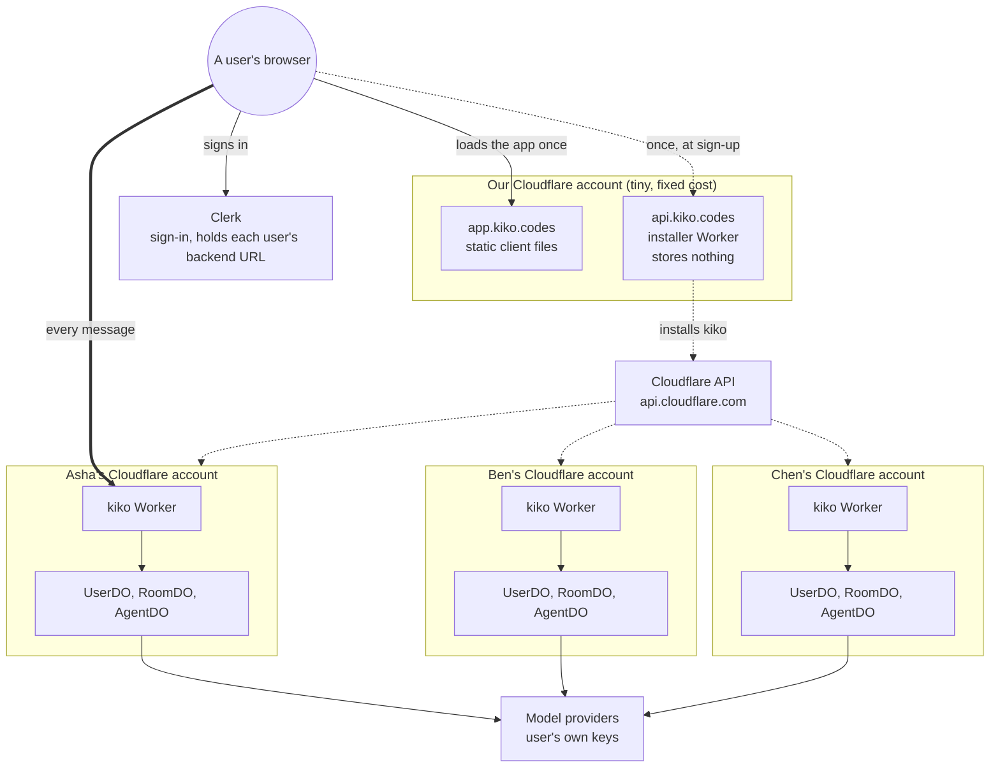
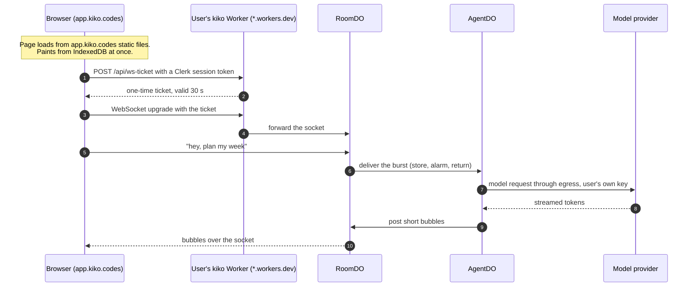
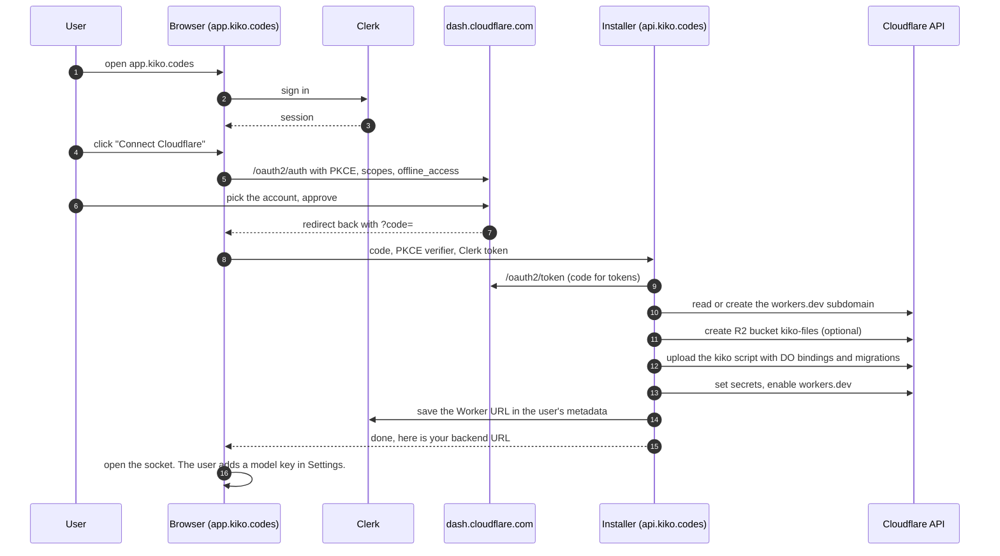
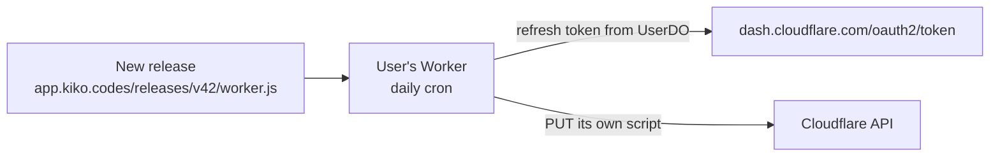

# app.kiko.codes: one front door, a private backend for each user

Status: plan. Nothing here is built yet. Written 2026-10-15.

This document is the plan for a hosted kiko at `app.kiko.codes`. A person signs in, connects their Cloudflare account with OAuth, and kiko installs its Worker and Durable Objects into that account. From then on they use kiko at `app.kiko.codes`. Their backend runs on a `*.workers.dev` hostname they never need to see.

It covers how the backend works, who talks to whom, how it scales to millions of users on the Workers Free plan, what it costs, what kiko has to change, and what is still unverified. Sources are at the end.

Labels follow the repo's rules. ASSUMPTION is a choice we made. UNVERIFIED is a fact we could not confirm. DEVIATION is a departure from `docs/architecture.md`.

## Contents

1. [The idea in one paragraph](#the-idea-in-one-paragraph)
2. [The three pieces](#the-three-pieces)
3. [Big picture](#big-picture)
4. [Who talks to the user](#who-talks-to-the-user)
5. [Joining: the install flow](#joining-the-install-flow)
6. [Auth: how a user's backend knows it is them](#auth-how-a-users-backend-knows-it-is-them)
7. [Updates](#updates)
8. [Why it scales](#why-it-scales)
9. [Cost by number of users](#cost-by-number-of-users)
10. [Clerk or Sign in with Cloudflare](#clerk-or-sign-in-with-cloudflare)
11. [How t3code does it, and where we differ](#how-t3code-does-it-and-where-we-differ)
12. [Changes kiko needs](#changes-kiko-needs)
13. [Risks and open questions](#risks-and-open-questions)
14. [Spike plan](#spike-plan)
15. [Glossary](#glossary)
16. [Sources](#sources)

## The idea in one paragraph

We host one shared front door. Each user gets their own private backend, in their own Cloudflare account, on their own free plan. The front door is static files, so it costs nothing to serve. Our only server is a small installer that runs once per user at sign-up. After that, every message a user sends goes from their browser straight to their own backend. Our servers are never on that path. Adding a user adds a backend in someone else's account, not load on ours.

Pitch for friends: "It's like a phone. We make the app, but every user brings their own phone line. A million users means a million phone lines, none of them ours."

## The three pieces

| Piece | Where it runs | Who pays | What it does | What it stores |
| --- | --- | --- | --- | --- |
| Front door, `app.kiko.codes` | Our Cloudflare account, Workers Static Assets | Us, $0 | Serves the SolidJS client: HTML, JS, CSS | Nothing |
| Installer, `api.kiko.codes` | Our Cloudflare account, one small Worker | Us, $0 until about 10k installs a day | Finishes the Cloudflare OAuth exchange and installs or updates kiko in the user's account | Nothing. The Worker URL goes into the user's Clerk metadata |
| User's backend, `kiko.<their-subdomain>.workers.dev` | The user's Cloudflare account | The user, $0 on Free | The whole of today's kiko: the Worker, `UserDO`, `RoomDO`, `AgentDO`, R2 files | All of the user's data and their encrypted model keys |

Model providers (Anthropic, OpenAI, and others) are called by the user's backend with the user's own keys. We never see the keys.

## Big picture

Solid thick line: the hot path, every message. Dotted lines: happen once per user. Nothing on the hot path is ours.

## Who talks to the user

The user's own backend talks to them. Here is one message, start to finish.

- Steps 1 to 4 happen once per tab. After that the socket stays open and hibernates when idle.
- Our installer and Clerk's servers are not in this picture. Clerk's token is checked by the user's Worker with a public key, with no call to Clerk.
- Everything from step 4 on is kiko as it works today. Sections 4, 6, 7, 8 and 9 of `docs/architecture.md` are unchanged.

## Joining: the install flow

About 10 Cloudflare API calls per install. It takes about 20 seconds.

Why there is an installer at all: neither `api.cloudflare.com` nor `dash.cloudflare.com/oauth2/token` sends CORS headers. We checked with `curl`. A browser cannot call them directly, so a server has to make these calls. The installer is that server, and it keeps nothing.

### Install steps in detail

| # | Call | Notes |
| --- | --- | --- |
| 1 | `POST https://dash.cloudflare.com/oauth2/token` | Authorization code plus PKCE verifier. Returns an access token and, with `offline_access`, a refresh token |
| 2 | `GET /client/v4/accounts` | The accounts the user chose on the consent screen |
| 3 | `GET /accounts/{id}/workers/subdomain`, `PUT` if missing | A new account may not have a workers.dev subdomain yet |
| 4 | `POST /accounts/{id}/r2/buckets` | `kiko-files`. Skipped if the user has no R2. See risks |
| 5 | `PUT /accounts/{id}/workers/scripts/kiko` | Multipart. Metadata carries `main_module`, `compatibility_date`, `compatibility_flags: ["nodejs_compat"]`, the bindings (`USER`, `ROOM`, `AGENT` as `durable_object_namespace`, `FILES` as `r2_bucket`) and the migrations from `apps/server/wrangler.jsonc` |
| 6 | Script secrets | `SESSION_SECRET`, `CREDENTIALS_KEK`, `OWNER_ID` (the Clerk user id), `CLERK_JWT_KEY`. Random values are made in the installer and never stored there |
| 7 | Enable the script on workers.dev | The script subdomain endpoint |
| 8 | Clerk Backend API: update the user's `publicMetadata` | `{ workerUrl, accountId, version }`. This is the only record of the install, so no database is needed |

The bundle in step 5 is the same build `bun run --cwd apps/server deploy` makes today. The installer reads it from our static assets, for example `app.kiko.codes/releases/<version>/worker.js`.

ASSUMPTION: the client files are not uploaded into the user's account. The user's Worker is API only. Optionally it can carry the client as a fallback, in case `app.kiko.codes` is ever down.

## Auth: how a user's backend knows it is them

Each user's Worker has exactly one owner, as today (AGENTS.md rule 5). What changes is how it checks the owner.

| Check | How | Network call? |
| --- | --- | --- |
| The token is a real Clerk session | Verify the JWT signature with Clerk's PEM public key (`jwtKey`, stored as a secret at install) | No |
| It is this backend's owner | `sub` equals `OWNER_ID`, set at install | No |
| It came from our app | `azp` equals `https://app.kiko.codes` (Clerk's `authorizedParties`) | No |
| The browser origin is ours | CORS allows only `https://app.kiko.codes`. The WebSocket upgrade checks `Origin` too | No |
| The socket URL has no long-lived secret | `POST /api/ws-ticket` with the Clerk token returns a one-time ticket that lives 30 seconds. The socket URL carries only the ticket | No, the ticket is HMAC-signed with `SESSION_SECRET` |

Inside the Worker, the owner id in `apps/server/src/lib/names.ts` stays the constant `owner`. The Clerk check only decides whether a request is the owner. Durable Object names do not change, so no data moves.

Model keys stay as they are (AGENTS.md rule 6). They are encrypted in `UserDO` with `CREDENTIALS_KEK` and never reach the client.

The `.workers.dev` URL is not a secret. Anyone can find it in the browser's network tab. That is fine: without the owner's Clerk token, every route answers 401.

## Updates

- Plan A, self-update. At install, the Cloudflare refresh token is stored encrypted in `UserDO`, like a model key. A daily cron in the user's Worker checks the release manifest. If there is a new version, it gets a fresh access token and uploads the new bundle to itself. Our installer is not involved, so updates cost us nothing at any scale. UNVERIFIED: whether the refresh token of a public PKCE client works from a Worker.
- Plan B, if plan A fails. The app shows "Update available". One click runs the OAuth flow again and the installer uploads the new bundle. It is the same cost as an install.
- A Durable Object migration (a new class, a rename) ships in the bundle's metadata, as in `wrangler.jsonc` today. Table changes need nothing, since `migrate` in `core/durable/src/migrate.ts` already runs on first access.
- The client and the backend can be on different versions for a while. The client reads `/api/version` and keeps one version of backward compatibility. ASSUMPTION.

## Why it scales

A normal chat app has one backend for everyone. More users means more servers, a bigger database, and on-call. Here, more users means more backends, each in its owner's account. Our side has nothing that grows with use.

| | Normal chat app | kiko |
| --- | --- | --- |
| Who runs the backend | The company | Each user, in their own Cloudflare account |
| Where messages go | Company servers | The user's own Worker |
| Database | One big shared one | One small set of Durable Objects per user |
| What grows with users | Servers, database, staff | Only sign-ups through the installer |
| One heavy user slows others | Yes | No, they use their own free plan |
| A breach exposes | Everyone | One account |

What grows on our side, and its limit:

| Our part | Grows with | Free plan limit | Enough for |
| --- | --- | --- | --- |
| `app.kiko.codes` | Page loads | Static asset requests are free and unlimited | Any number |
| `api.kiko.codes` | Installs only, about 10 requests each | 100,000 requests a day | About 10,000 new users a day |
| Clerk | Monthly active users | 50,000 on Hobby | See cost |

What each user gets on their own Free plan: 100,000 Worker requests a day, Durable Objects with SQLite storage up to 5 GB per account, and 30 seconds of CPU per Durable Object request. One person chatting all day uses a small part of that. The per-turn cost math is in `docs/architecture.md` section 17.

## Cost by number of users

Our monthly bill, at list prices on 2026-10-15.

| Users | `app.kiko.codes` | Installer | Clerk | Total with Clerk | Total with Sign in with Cloudflare |
| --- | --- | --- | --- | --- | --- |
| 1,000 | $0 | $0 | $0 (Hobby) | $0 | $0 |
| 100,000 | $0 | $0 | about $1,025 (Pro $25 plus $0.02 per user above 50,000) | about $1,025 | $0 |
| 1,000,000 | $0 | about $5 (Workers Paid, if installs pass 10k a day) | up to about $19,025 before volume discounts | about $19,030 | about $5 |

Users pay $0 to Cloudflare on the Free plan, plus their own model usage. R2 is free up to 10 GB a month, but turning R2 on asks for a card.

## Clerk or Sign in with Cloudflare

Every user already has to have a Cloudflare account. So Cloudflare can be the sign-in too.

| | Clerk | Sign in with Cloudflare |
| --- | --- | --- |
| Cost at 1M users | Up to about $19k a month | $0 |
| Sign-in steps for a new user | Clerk sign-up, then Cloudflare consent | Cloudflare consent only |
| Where the backend URL is kept | Clerk `publicMetadata` | Read from the user's account on each sign-in, through the installer: `GET /accounts/{id}/workers/subdomain` |
| How the user's Worker checks the owner | Clerk JWT, offline | The Worker issues its own session after checking the Cloudflare token against `/oauth2/userinfo` once. UNVERIFIED |
| Ready-made mobile SDKs, Google and Apple sign-in | Yes | No |
| Same as t3code | Yes | No |

Recommendation: Sign in with Cloudflare, unless the mobile apps need Clerk's SDKs. The cost line decides it at scale. The rest of this document assumes Clerk because that was the stated choice. Switching changes only the auth table above and step 8 of the install.

## How t3code does it, and where we differ

t3code (`app.t3.codes`) solves a similar problem: one hosted web app that talks to many user-owned servers.

| | t3code | kiko plan |
| --- | --- | --- |
| Hosted app | Static app on Vercel, `latest` and `nightly` channels picked by a cookie (`apps/web/vercel.ts`) | Static app on Workers Static Assets |
| Users' backends | The t3 server on the user's own machine | kiko on the user's own Cloudflare account |
| Reaching the backend | Per-user Cloudflare Tunnels set up by the relay | A public `*.workers.dev` URL, no tunnel needed |
| Central server | `infra/relay`, a Cloudflare Worker deployed with Alchemy, with Clerk and PlanetScale through Hyperdrive | `api.kiko.codes`, a Worker with no database |
| Is the central server on the hot path | No | No |
| Connection list | Stored in the browser | Clerk metadata, cached in the browser |
| Pairing | A DPoP-bound one-time bootstrap credential, in a URL fragment, traded with the user's server for a session | The OAuth install itself. The installer writes the owner id into the Worker as a secret |
| Socket auth | A short-lived ticket from HTTP, so long-lived tokens stay out of socket URLs | The same |

What we copy: a static app, a central server that is off the hot path, and short-lived socket tickets. What we drop: tunnels, because Workers are already public, and a database, because Clerk metadata or the user's own account holds the one fact we need.

## Changes kiko needs

Each of these goes into `docs/architecture.md` as a DEVIATION in the pull request that makes it.

| Area | Today | Hosted | Where |
| --- | --- | --- | --- |
| Sign-in | Access code, HMAC session cookie | Clerk JWT checked offline, plus a socket ticket. The access code stays for people who self-deploy by hand | `architecture.md` section 10, `apps/server/src/auth/` |
| One origin | Client, API and sockets share a hostname | The client is on `app.kiko.codes` and the API on `*.workers.dev`. CORS allows only `app.kiko.codes` | `architecture.md` section 3, "One Worker, one origin" |
| Socket upgrade | Checked with the session cookie | Checked with a one-time ticket | `architecture.md` section 9.1 |
| Uploads | Carry the session cookie (same-origin) | Carry the Clerk token in a header | `architecture.md`, the R2 uploads section (the DEVIATION from t3code on the session cookie) |
| R2 | Required binding `FILES` | Optional. Attachments are off if the bucket is missing | `apps/server/wrangler.jsonc`, upload routes |
| Client API base | Same origin, `/api` | A base URL from Clerk metadata | `apps/web-solid/src/sync/` |
| Self-update | None | Daily cron and the stored refresh token | New, in `UserDO` |
| AGENTS.md "Do not add a second owner" | No sign-up, no accounts | Still one owner per Worker. Sign-up lives on `app.kiko.codes`, not in the Worker. The line needs rewording, not removing | `AGENTS.md` |

What does not change: Durable Object layout and names, the room and agent protocol, memory, egress, the Free plan design. Manual self-deploy (`docs/self-deploy.md`) keeps working.

## Risks and open questions

| # | Question | Why it matters | Fallback |
| --- | --- | --- | --- |
| 1 | Which OAuth scopes allow a full install: script upload with Durable Object migrations, secrets, the workers.dev subdomain, R2 buckets. UNVERIFIED | If a scope is missing, OAuth cannot do a full install | The user pastes an API token once, or uses a Deploy to Cloudflare button |
| 2 | Does a public PKCE client's refresh token work from a Worker. UNVERIFIED | Decides plan A for updates | Plan B, one-click update |
| 3 | Is there a cap on how many users can authorize a public OAuth client. UNVERIFIED | Caps sign-ups | Ask Cloudflare. Several clients |
| 4 | R2 asks the user for a card | Friction at sign-up | Make files optional. Turn on later from Settings |
| 5 | Each user needs a Cloudflare account | The biggest step for a new user | None. It is the price of $0 at scale. Cloudflare sign-up is quick |
| 6 | A script called `kiko` already exists in the account | Overwriting it would break something | Check first. Use `kiko-<short id>` |
| 7 | Going public with the OAuth client is permanent and needs a DNS TXT record on `kiko.codes` | One-way step | Test with a private client first |
| 8 | Workers Free gives 10 ms of CPU per Worker request | Already handled. Heavy work is in Durable Objects (`architecture.md` section 17.3) | None needed |
| 9 | Uninstall | People need a way out | "Delete my backend" in Settings deletes the script and bucket, then revokes the grant through `/oauth2/revoke`. The user can also revoke from the Cloudflare dashboard |

## Spike plan

Small, throwaway, a test Cloudflare account. It answers questions 1 to 3.

1. Create a private OAuth client in the Cloudflare dashboard with redirect `http://localhost:5173/callback`, PKCE, `offline_access`.
2. Read `GET /client/v4/oauth/scopes` and pick the smallest set that covers the install.
3. A script that runs the install steps above against the test account with a minimal Worker that has one SQLite Durable Object and one migration.
4. From that Worker, use the stored refresh token to upload a new version of itself.
5. Write the results into this document and remove the UNVERIFIED labels that it settles.

Then build in this order: the installer, Clerk auth in the Worker behind a flag, the client's API base URL, optional R2, self-update, uninstall.

## Glossary

- **Front door.** `app.kiko.codes`. Static files only.
- **Installer.** `api.kiko.codes`. Runs at sign-up and for plan B updates. Stores nothing.
- **Backend.** One user's kiko Worker and Durable Objects, in their account.
- **OAuth client.** kiko's registration with Cloudflare, so users can approve it on `dash.cloudflare.com`.
- **PKCE.** A way for a browser app to do OAuth without a client secret.
- **Hot path.** What runs on every message. Here, only the user's backend and their model provider.
- **Socket ticket.** A one-time token, valid 30 seconds, that opens a WebSocket.

## Sources

Checked 2026-10-15. Every link returned 200.

### Cloudflare OAuth

- [Changelog: public OAuth clients, 2026-06-03](https://developers.cloudflare.com/changelog/post/2026-06-03-public-oauth-clients/). Self-managed OAuth clients, private and public.
- [Changelog: OAuth consent and revoke, 2026-04-14](https://developers.cloudflare.com/changelog/post/2026-04-14-oauth-consent-and-revoke/). Account picking on consent, revoking access.
- [OAuth overview](https://developers.cloudflare.com/fundamentals/oauth/)
- [Create an OAuth client](https://developers.cloudflare.com/fundamentals/oauth/create-an-oauth-client/). Authorization code only, PKCE for browser apps, token auth methods, the publisher DNS record.
- [Integrate with Cloudflare](https://developers.cloudflare.com/fundamentals/oauth/integrate-with-cloudflare/). Endpoints `/oauth2/auth`, `/oauth2/token`, `/oauth2/revoke`, `/oauth2/userinfo`, `/oauth2/device/auth`, and `offline_access`.
- [Authorizing an application](https://developers.cloudflare.com/fundamentals/oauth/authorizing-an-application/). What the user sees and how they revoke.

### Cloudflare Workers and Durable Objects

- [Workers limits](https://developers.cloudflare.com/workers/platform/limits/). Free: 100,000 requests a day, 10 ms CPU, 50 subrequests, Worker count, cron triggers.
- [Workers pricing](https://developers.cloudflare.com/workers/platform/pricing/). Free and Paid ($5 a month).
- [Workers Static Assets](https://developers.cloudflare.com/workers/static-assets/). Asset requests are free and unlimited.
- [workers.dev routing](https://developers.cloudflare.com/workers/configuration/routing/workers-dev/)
- [Durable Objects limits](https://developers.cloudflare.com/durable-objects/platform/limits/). Free: SQLite storage only, 5 GB per account, 30 s CPU per request.
- [Durable Objects pricing](https://developers.cloudflare.com/durable-objects/platform/pricing/)
- [API: upload a Worker script](https://developers.cloudflare.com/api/resources/workers/subresources/scripts/methods/update/). Multipart metadata, bindings, migrations.
- [API: workers.dev subdomains](https://developers.cloudflare.com/api/resources/workers/subresources/subdomains/)
- [R2 pricing](https://developers.cloudflare.com/r2/pricing/). 10 GB a month free.
- [Deploy to Cloudflare buttons](https://developers.cloudflare.com/workers/platform/deploy-buttons/). The fallback for risk 1.
- [Workers for Platforms](https://developers.cloudflare.com/cloudflare-for-platforms/workers-for-platforms/). Considered and not chosen: it runs every user on our account and our bill.
- [Workers docs index, llms.txt](https://developers.cloudflare.com/workers/llms.txt)

### Clerk

- [Clerk pricing](https://clerk.com/pricing). Hobby free to 50,000 monthly retained users. Pro $25 a month plus $0.02 per user above that.
- [Manual JWT verification](https://clerk.com/docs/guides/sessions/manual-jwt-verification). The `azp` claim and authorized parties.
- [`verifyToken()`](https://clerk.com/docs/reference/backend/verify-token). Offline checks with `jwtKey`.

### t3code

- [pingdotgg/t3code](https://github.com/pingdotgg/t3code)
- [`docs/internals/t3-connect.md`](https://github.com/pingdotgg/t3code/blob/main/docs/internals/t3-connect.md). How the hosted app reaches user servers.
- [`docs/internals/environment-auth.md`](https://github.com/pingdotgg/t3code/blob/main/docs/internals/environment-auth.md). Bootstrap credentials, sessions, socket tickets.
- [`docs/internals/remote.md`](https://github.com/pingdotgg/t3code/blob/main/docs/internals/remote.md)
- [`docs/operations/connect-setup.md`](https://github.com/pingdotgg/t3code/blob/main/docs/operations/connect-setup.md)
- [`infra/relay`](https://github.com/pingdotgg/t3code/tree/main/infra/relay). The relay Worker, Alchemy deploy, Clerk, PlanetScale through Hyperdrive.
- [`apps/web/vercel.ts`](https://github.com/pingdotgg/t3code/blob/main/apps/web/vercel.ts). The static hosted app and its channels.

### In this repo

- `apps/server/wrangler.jsonc`. Bindings and Durable Object migrations the installer copies.
- `docs/self-deploy.md`. Today's manual install, which stays.
- `docs/architecture.md` sections 3, 9.1, 10, 11 and 17. The parts this plan changes or relies on.
- `AGENTS.md` rules 5 and 6, which still hold.

### Checked by hand

- `curl -i -X OPTIONS https://api.cloudflare.com/client/v4/accounts -H 'Origin: https://app.kiko.codes'` and the same for `https://dash.cloudflare.com/oauth2/token`. Neither returns an `Access-Control-Allow-Origin` header. That is why the installer exists.
