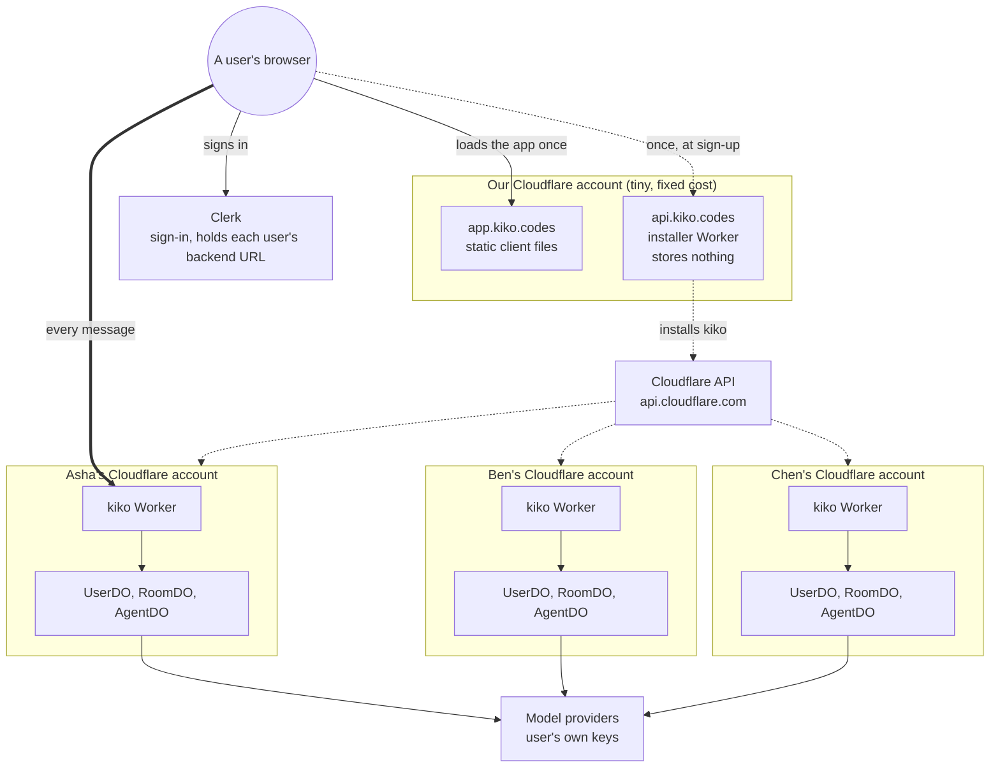
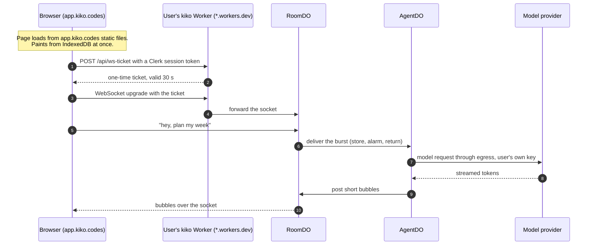
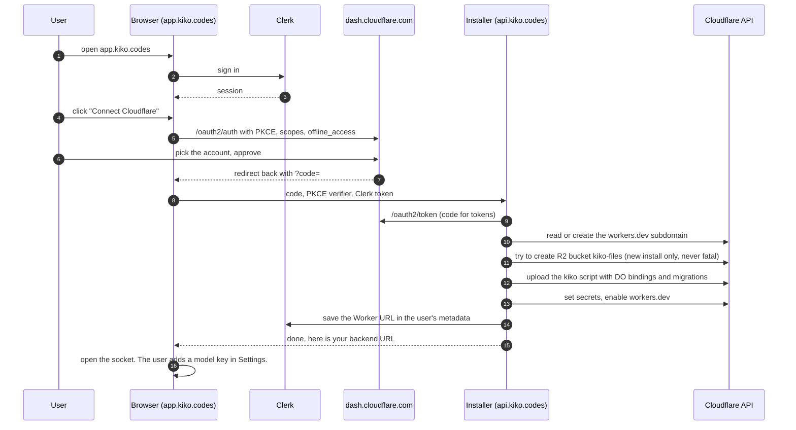
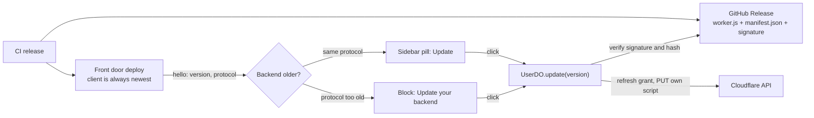

# app.kiko.codes: one front door, a private backend for each user

Status: plan, spiked. Nothing here is built yet. Written 2026-10-15. The section [Decisions and spike results](#decisions-and-spike-results) overrides older text below where they disagree.

This document is the plan for a hosted kiko at `app.kiko.codes`. A person signs in, connects their Cloudflare account with OAuth, and kiko installs its Worker and Durable Objects into that account. From then on they use kiko at `app.kiko.codes`. Their backend runs on a `*.workers.dev` hostname they never need to see.

It covers how the backend works, who talks to whom, how it scales to millions of users on the Workers Free plan, what it costs, what kiko has to change, and what is still unverified. Sources are at the end.

Labels follow the repo's rules. ASSUMPTION is a choice we made. UNVERIFIED is a fact we could not confirm. DEVIATION is a departure from `docs/architecture.md`.

## Contents

0. [Decisions and spike results](#decisions-and-spike-results)
1. [The idea in one paragraph](#the-idea-in-one-paragraph)
2. [The three pieces](#the-three-pieces)
3. [Big picture](#big-picture)
4. [Who talks to the user](#who-talks-to-the-user)
5. [Joining: the install flow](#joining-the-install-flow)
6. [Auth: how a user's backend knows it is them](#auth-how-a-users-backend-knows-it-is-them)
7. [Updates](#updates)
8. [Why it scales](#why-it-scales)
9. [Cost by number of users](#cost-by-number-of-users)
10. [Clerk or Sign in with Cloudflare](#clerk-or-sign-in-with-cloudflare)
11. [How t3code does it, and where we differ](#how-t3code-does-it-and-where-we-differ)
12. [Changes kiko needs](#changes-kiko-needs)
13. [Risks and open questions](#risks-and-open-questions)
14. [Spike plan](#spike-plan)
15. [Glossary](#glossary)
16. [Sources](#sources)

## Decisions and spike results

Settled on 2026-10-15.

### Decisions

- **Clerk for sign-in.** Google and GitHub only. No email, password, or phone. The client uses `@clerk/clerk-js` directly, headless, with our own two buttons. It does not use `clerk-solidjs`: that port is unofficial, its server half needs SolidStart, and it trails Clerk's releases. clerk-js loads only on the sign-in screen, so tiers 1 to 3 do not grow.
- **Clerk checks the owner once.** The client trades a Clerk session token for the backend's own session at `POST /api/auth/clerk`. The backend verifies the token offline with the instance's public key and checks `sub` against `OWNER_ID`. From then on the client holds the backend's session token. Sockets and file links never wait on Clerk.
- **One backend session, three carriers.** The session is a bearer token in the `Authorization` header for `fetch`, a 30-second ticket for each socket upgrade, and a signed, short-lived URL for each file. Tickets and file URLs are minted by the backend, so a chat switch costs no extra round trip to anyone but the backend. The access code stays for manual self-deploy. Cookies are gone: H03 built the bearer, the `kiko` socket subprotocol, `?t=` file tokens and CORS for trusted origins.
- **The front door is `app.kiko.works`.** The front door, the installer, and Clerk's production instance (`clerk.kiko.works`, `accounts.kiko.works`) live on kiko.works, in the same Cloudflare account.
- **One way in.** The front door Worker (`apps/server/src/front-door.ts`, `wrangler.front-door.jsonc`, deployed by `issues/bin/deploy-front-door.sh`) is the only page that signs anyone in, with Clerk. The installer (`issues/bin/deploy-installer.sh`) is `api.kiko.works`. Every backend, the owner's included, is installed through the front door, so there is no separate backend deploy. Both Workers answer a missing `/assets/` file with an uncached 404 (`apps/server/src/lib/assets.ts`), because single-page mode would return `index.html` under a one-year cache header and a browser that asked during a deploy would never boot again.
- **Landing page in Astro.** It is its own static site and its own Worker. It does not share a build with the client.
- **Updates are one click, like t3code.** There is no nightly channel and no automatic update. Details are in the Updates section.
- **The installer accepts two grants.** It accepts a Cloudflare OAuth code, or an API token the user pastes from a prefilled token link. Both reach the same install code.

### Spike results

Run against the owner's account with a throwaway Worker. The Worker was deleted afterwards.

- **Install works through the API alone.** `PUT /accounts/{id}/workers/scripts/{name}` with multipart metadata created a Worker with a SQLite Durable Object class (`migrations.new_sqlite_classes`) and a `secret_text` binding. `POST .../scripts/{name}/subdomain` with `{"enabled":true}` put it on workers.dev. The first request answered within about 15 seconds.
- **Update keeps data and secrets.** A second `PUT` with `keep_bindings: ["secret_text"]` and `migrations: {old_tag, new_tag}` replaced the code. The Durable Object's rows survived (hit count 2, then 3), the secret was still listed, and the new code served within about 20 seconds.
- **OAuth scope names are known.** `GET /client/v4/oauth/scopes` lists 397 scopes. The install needs `workers-scripts.write` and `account-settings.read`, plus `workers-r2.write` for files. `offline_access` is added by the `refresh_token` grant.
- **OAuth clients can be made by API.** `POST /accounts/{id}/oauth_clients`. The owner's stored API token can list them. A client can set `allowed_cors_origins`.
- **A private OAuth client only serves members of our own account.** The docs say: "Private clients can only be authorized by members of the parent Cloudflare account." A public client needs a verified domain, through a TXT record. A workers.dev hostname cannot carry one. So until we own a domain, other people install with a pasted API token.
- **Clerk development instances stop at 100 users.** Users cannot be moved between instances, and a production instance needs a domain. A user's Clerk id changes when we move to production, so the backend must let the owner rebind `OWNER_ID`. Rebinding takes a fresh Cloudflare grant, which proves the owner holds the account.
- **Clerk keys work.** The backend API answers for instance `ins_3KjwHJtGnPC9vMXebWX1NsceqbX`, a development instance on `smart-rooster-2969.clerk.accounts.dev`, with 0 users. Keys live in `~/.config/kiko/dev.vars`.

### Corrections to the text below

- The installer's limit is not "10 requests per install". An install is about 2 requests into the installer and about 10 subrequests out of it. Subrequests count against 50 per invocation, not against 100,000 a day.
- Building an 8 MB multipart body in a Free Worker handler risks the CPU stop measured in `docs/architecture.md` section 17.3. The installer does the upload inside a Durable Object.
- Self-update runs from a `UserDO` alarm or an RPC, never from a Worker cron.
- A stateless ticket cannot be one-time. It is valid for 30 seconds.
- Images and file links use `` and `href`, which cannot carry a header. They need signed URLs, not only uploads.
- "A breach exposes one account" holds only if releases are signed. A forged release could otherwise reach every backend.

### Clerk sign-in, as built (build item 3)

- **Server.** `POST /api/auth/clerk` is in `apps/server/src/auth/clerk.ts`, with no `@clerk/backend` dependency: the check is RS256 through WebCrypto. `CLERK_JWT_KEY` takes the PEM, or the same key as bare base64 or with `\n` for line breaks, so it passes through `wrangler --var` on one line.
- **Client.** A build with `VITE_CLERK_PUBLISHABLE_KEY` is hosted. The `/welcome` screen (`app/first-run/`) takes its sign-in step from `app/first-run/clerk-step.tsx` in place of the access code: Clerk's prebuilt sign-in modal over the step (as t3code does). A person Clerk knows with no backend yet gets the Cloudflare step, which also serves `/connect` and `/connect/callback`. Providers come from the Clerk dashboard. `@clerk/clerk-js` (about 570 KB gzip) is its own lazy chunk, reached only from the sign-in screen and sign-out. It ships without the prebuilt components, so `app/clerk.ts` hotloads `@clerk/ui` from the instance's front-end host and passes it to `load`. The cached profile is `kiko:profile`.

### Front door deploy, as built

- **Two Workers in our account.** `kiko-app` (`apps/web-solid/wrangler.jsonc`) serves the hosted client and the signed release under `/releases`, as static assets only. `kiko-installer` (`apps/installer`) runs the install. The front door is not named `kiko`: the installer adopts a `kiko` script that answers `/api/version` as its owner's backend, so a front door by that name in the owner's own account would be replaced by a backend with no client.
- **One command.** `VITE_CLERK_PUBLISHABLE_KEY=... VITE_INSTALLER_URL=... bun scripts/deploy-front-door.ts` builds the client, builds and signs the release (`scripts/release.ts`), copies it into `dist/releases`, and deploys `kiko-app`.
- **Installer secrets.** `CF_OAUTH_CLIENT_ID`, `CLERK_SECRET_KEY`, `CLERK_JWT_KEY` (the instance's PEM, from Clerk's JWKS), `TRUSTED_ORIGINS` and `FRONT_DOOR_ORIGIN` (the front door's origin), `RELEASE_BASE_URL` (`<front door>/releases`), `RELEASE_PUBLIC_KEY`. The OAuth client's redirect URIs must include `<front door>/connect/callback`.
- **Adopting a backend.** Every install, first or not, sets `OWNER_ID`, `CLERK_JWT_KEY`, `TRUSTED_ORIGINS`, `RELEASE_BASE_URL`, and `CF_GRANT` on the backend (`boundSecrets` in `apps/installer/src/plan.ts`). A backend deployed by hand has none of the first four, and would refuse the front door without them. Only `SESSION_SECRET` and `CREDENTIALS_KEK` are first-install only, so an adopted backend keeps its sessions and stored keys.

### Connect Cloudflare, as built (build item 10)

- **Default look while signed out.** Imported VS Code themes belong to the browser, not the person, so the signed-out screens skip them and paint the default look. Signing in turns them back on.
- **Screen.** `app/connect.tsx` (lazy) with pure steps in `app/connect-flow.ts`. The installer base is `VITE_INSTALLER_URL`. A production build with `VITE_CLERK_PUBLISHABLE_KEY` and no `VITE_INSTALLER_URL` fails, because the client would otherwise ask its own host, get the app's HTML back, and show a JSON parse error. Any installer answer that is not JSON of the right shape shows "Could not reach the installer. Try again." It is a step of the `/welcome` screen and, for "Reconnect Cloudflare" on the Account page (`/connect?reconnect=1`), in the signed-in routes.
- **OAuth.** The client reads `/oauth/config`, makes a PKCE verifier, S256 challenge and state, keeps verifier and state in `sessionStorage`, and redirects. `/connect/callback` checks state before any request, then posts the grant to `/install`. An OAuth code is single use, so "Try again" after an OAuth failure starts the sign-in over. A token grant retries as is.
- **Token.** "Use an API token instead" shows the link and permissions from `/token-link`, a password field, and Install.
- **Success.** `kiko:backend` is stored first. Then a fresh Clerk token (the install outlives the first one) is traded at `/api/auth/clerk`.
- **Errors.** `r2_disabled` and `no_subdomain` link to the Cloudflare dashboard. The dashboard deep links are ASSUMPTION: UNVERIFIED that `?to=/:account/...` resolves for every account.
- **Progress.** The four steps are listed as plain text with no per-step timing, because the install is one request.
- **One sign-out.** `signOut()` in `app/session.ts` ends the Clerk session first, then drops the token, snapshot, warm tier, and profile. `kiko:backend` stays. A 401 alone leaves the Clerk session, so the sign-in screen signs the person back in without a click.
- **Settings.** Account is its own section, `/settings/account` (the `account` alias to General is gone).
- **Dev instance.** It has no email identifier, so a test user gets a `username`, which is what a sign-in token needs. `scripts/clerk-dev.ts up|ticket|down` and `bun kiko verify clerk` drive it. A dev build of the client accepts `/?ticket=<sign-in token>` (`app/dev-ticket.ts`, dropped from production builds).

### Moving to a domain

1. Ship a backend release that adds the new origin to `TRUSTED_ORIGINS`, so both origins work.
2. Point the domain at the front door Worker. Make the OAuth client public with the TXT record. Create the Clerk production instance with Google and GitHub credentials of our own.
3. Each user signs in once on the new origin and reconnects Cloudflare. That rebinds `OWNER_ID` to the production Clerk id. IndexedDB is per origin, so the first paint there comes from the server.

### Build order

Each item is one pull request.

1. **Versions.** `PROTOCOL` in `@kiko/protocol`, the build version in the client and in the Worker, and both in the user socket's `hello`. A quiet pill in the sidebar foot when the backend is older, and a compact notice above the composer when its protocol is too old.
2. **Cross-origin client.** One API base for every fetch, socket, and upload. The bearer session, socket tickets, and signed file URLs on the server. CORS for trusted origins.
3. **Clerk sign-in.** `POST /api/auth/clerk` on the backend. The sign-in screen with Google and GitHub. The Account settings page.
4. **Installer and front door.** The installer Worker with OAuth and pasted-token grants, and the front door deploy.
5. **One-click update.** Signed release manifest, `UserDO` self-update, progress over the user socket, and the Version row in settings.
6. **Landing page.** Astro.
7. **Uninstall.** "Delete my backend" in Account settings.

## The idea in one paragraph

We host one shared front door. Each user gets their own private backend, in their own Cloudflare account, on their own free plan. The front door is static files, so it costs nothing to serve. Our only server is a small installer that runs once per user at sign-up. After that, every message a user sends goes from their browser straight to their own backend. Our servers are never on that path. Adding a user adds a backend in someone else's account, not load on ours.

Pitch for friends: "It's like a phone. We make the app, but every user brings their own phone line. A million users means a million phone lines, none of them ours."

## The three pieces

| Piece | Where it runs | Who pays | What it does | What it stores |
| --- | --- | --- | --- | --- |
| Front door, `app.kiko.codes` | Our Cloudflare account, Workers Static Assets | Us, $0 | Serves the SolidJS client: HTML, JS, CSS | Nothing |
| Installer, `api.kiko.codes` | Our Cloudflare account, one small Worker | Us, $0 until about 10k installs a day | Finishes the Cloudflare OAuth exchange and installs or updates kiko in the user's account | Nothing. The Worker URL goes into the user's Clerk metadata |
| User's backend, `kiko.<their-subdomain>.workers.dev` | The user's Cloudflare account | The user, $0 on Free | The whole of today's kiko: the Worker, `UserDO`, `RoomDO`, `AgentDO`, R2 files | All of the user's data and their encrypted model keys |

Model providers (Anthropic, OpenAI, and others) are called by the user's backend with the user's own keys. We never see the keys.

## Big picture

Solid thick line: the hot path, every message. Dotted lines: happen once per user. Nothing on the hot path is ours.

## Who talks to the user

The user's own backend talks to them. Here is one message, start to finish.

- Steps 1 to 4 happen once per tab. After that the socket stays open and hibernates when idle.
- Our installer and Clerk's servers are not in this picture. Clerk's token is checked by the user's Worker with a public key, with no call to Clerk.
- Everything from step 4 on is kiko as it works today. Sections 4, 6, 7, 8 and 9 of `docs/architecture.md` are unchanged.

## Joining: the install flow

About 10 Cloudflare API calls per install. It takes about 20 seconds.

Why there is an installer at all: neither `api.cloudflare.com` nor `dash.cloudflare.com/oauth2/token` sends CORS headers. We checked with `curl`. A browser cannot call them directly, so a server has to make these calls. The installer is that server, and it keeps nothing.

### Install steps in detail

| # | Call | Notes |
| --- | --- | --- |
| 1 | `POST https://dash.cloudflare.com/oauth2/token` | Authorization code plus PKCE verifier. Returns an access token and, with `offline_access`, a refresh token |
| 2 | `GET /client/v4/accounts` | The accounts the user chose on the consent screen |
| 3 | `GET /accounts/{id}/workers/subdomain`, `PUT` if missing | A new account may not have a workers.dev subdomain yet |
| 4 | `POST /accounts/{id}/r2/buckets` | `kiko-files`, only when the script is new. Any failure is ignored: the install then has no `FILES` binding and keeps files in `FileDO` (architecture section 18.1). An existing script keeps the binding it has (`inherit`) |
| 5 | `PUT /accounts/{id}/workers/scripts/kiko` | Multipart. Metadata carries `main_module`, `compatibility_date`, `compatibility_flags: ["nodejs_compat"]`, the bindings (`USER`, `ROOM`, `AGENT` as `durable_object_namespace`, `FILE` as `durable_object_namespace`, `FILES` as `r2_bucket` only when step 4 made or found the bucket) and the migrations from `apps/server/wrangler.jsonc` |
| 6 | Script secrets | `SESSION_SECRET`, `CREDENTIALS_KEK`, `OWNER_ID` (the Clerk user id), `CLERK_JWT_KEY`. Random values are made in the installer and never stored there |
| 7 | Enable the script on workers.dev | The script subdomain endpoint |
| 8 | Clerk Backend API: update the user's `publicMetadata` | `{ workerUrl, accountId, version }`. This is the only record of the install, so no database is needed |

### First-run failures (R34)

A new Cloudflare account must reach a working Kiko with no dashboard visit. The installer handles what the API allows and otherwise sends one plain sentence, one link, and Try again (`failureOf` in `connect-flow.ts`). A retry resumes: every step looks at what exists and carries on.

| What goes wrong | What the installer does | Code |
| --- | --- | --- |
| No workers.dev subdomain | Makes one (`PUT /workers/subdomain`). If that fails, links to Workers | `no_subdomain` |
| R2 not turned on, no R2 plan, or any R2 error | Installs without the binding. Files live in `FileDO` | none |
| The sign-in lists accounts it cannot change Workers on | Uses the first account whose scripts it can list | none |
| Every account refuses the sign-in (401, 403, 10000, 9109) | Sentence and a link to Workers | `no_permission` |
| No account | Link to Cloudflare sign-up | `no_account` |
| Rate limit (429) | Wait a minute | `busy` |
| Cloudflare 5xx | Link to Cloudflare status | `cloudflare_down` |
| The script is up but does not answer within 60 s | Link to Workers, Try again | `not_ready` |
| A script named `kiko` that is not Kiko | Installs as `kiko-<hash>` | none |
| The sign-in code was used or expired | Starts the sign-in again, which Cloudflare approves at once | `oauth_failed` |
| The token may change but not create Workers (Workers Editor) | Edit the token to Workers Admin, link to API tokens | `cannot_create` |
| The sign-in can use several accounts and none runs Kiko | A list of the accounts to pick | `choose_account` |
| Installed, but this device cannot reach the new address yet | Names the address, mentions VPN or Private DNS; Try again signs in only | `unreachable` |

UNVERIFIED: that an unverified email blocks any of these calls. Cloudflare documents no such rule for the Workers API. The unmapped case falls under `cloudflare_error`: a sentence and a link to Workers.

No new OAuth scope is needed: `workers-scripts.write` covers the subdomain, the upload, and the secrets, `account-settings.read` lists accounts, and `workers-r2.write` is used only to try the bucket.

The bundle in step 5 is the same build `bun run --cwd apps/server deploy` makes today. The installer reads it from our static assets, for example `app.kiko.codes/releases/<version>/worker.js`.

DEVIATION (H05, as built in `apps/installer`): the script is named `kiko`, the bucket `kiko-files`, and the metadata key is `backendUrl`, not `workerUrl`. The Worker handler only checks the Clerk token and the origin. It hands the install to the `Installer` object (one per Clerk user), which builds the multipart upload. The installer reads a signed release (`latest.json`, `<version>/manifest.json`, `manifest.sig`, modules) from `RELEASE_BASE_URL`, not a bare `worker.js`, and refuses any release whose Ed25519 signature or module hash does not match (`scripts/release.ts`, `core/durable/src/release.ts`). If `kiko` already exists and does not answer `/api/version` like kiko, the script is named `kiko-<6 hex of sha256(sub)>`. The secrets go in the upload metadata on first install. An update sends `keep_bindings: ["secret_text"]` and never regenerates `SESSION_SECRET` or `CREDENTIALS_KEK`. It sets `OWNER_ID` and `CF_GRANT` through the secrets endpoint every time, because a secret's value cannot be read back to compare.

`GET /token-link` returns a user token template URL (`/profile/api-tokens?permissionGroupKeys=...&accountId=*&zoneId=all`, [docs](https://developers.cloudflare.com/fundamentals/api/how-to/account-owned-token-template/)) with `workers_scripts` edit, `account_settings` read, and `workers_r2` edit, plus the permission list. Since Cloudflare's Workers roles (2026-09), Workers Editor "Cannot create or delete Workers" and Workers Admin is the old Workers Scripts Write. A Workers Editor token was tested live: the script upload answers 403, so the list asks for Workers Admin and a 403 on creating the Worker is `cannot_create`. UNVERIFIED: which of the two roles the `workers_scripts` edit template key ticks. The OAuth client asks for `workers-scripts.write`, the legacy scope, which still creates Workers (tested with a token of the matching permission group).

Account choice: an account that already runs Kiko wins, one usable account is used, and with several the installer answers `choose_account` with their names and the client asks. Only while the person picks does the installer hold the tokens an OAuth code was traded for (10 minutes, in the `Installer` object, handed over once), so the pick can send the same code again. Any other failure of an OAuth install starts a new sign-in, because a code works once. A token Cloudflare does not know (9109 "Invalid access token", or 6003 for a paste that is not a token) is `bad_token`, not `no_permission`, and the page asks for the token again. Key and token fields are text fields drawn as dots, so the browser never saves an old key and fills it back in. A workers.dev address the install made is handed out only when 1.1.1.1 and 8.8.8.8 resolve it (up to 90 s), and the client's first sign-in to a new backend retries a missing answer for 90 s. Every installer error carries Cloudflare's own message and the failing call as `detail`, which the page shows under its sentence.

UNVERIFIED: the installer reads the current migration tag from `migration_tag` in the scripts list (`GET /accounts/{id}/workers/scripts`), and treats Cloudflare code 10073 (bucket exists) as success; 10042 (not entitled, R2 not enabled).

ASSUMPTION: the client files are not uploaded into the user's account. The user's Worker is API only. Optionally it can carry the client as a fallback, in case `app.kiko.codes` is ever down.

## Auth: how a user's backend knows it is them

Each user's Worker has exactly one owner, as today (AGENTS.md rule 5). What changes is how it checks the owner.

| Check | How | Network call? |
| --- | --- | --- |
| The token is a real Clerk session | Verify the JWT signature with Clerk's PEM public key (`jwtKey`, stored as a secret at install) | No |
| It is this backend's owner | `sub` equals `OWNER_ID`, set at install | No |
| It came from our app | `azp` equals `https://app.kiko.codes` (Clerk's `authorizedParties`) | No |
| The browser origin is ours | CORS allows only `https://app.kiko.codes`. The WebSocket upgrade checks `Origin` too | No |
| The socket URL has no long-lived secret | `POST /api/ws-ticket` with the Clerk token returns a one-time ticket that lives 30 seconds. The socket URL carries only the ticket | No, the ticket is HMAC-signed with `SESSION_SECRET` |

Inside the Worker, the owner id in `apps/server/src/lib/names.ts` stays the constant `owner`. The Clerk check only decides whether a request is the owner. Durable Object names do not change, so no data moves.

Model keys stay as they are (AGENTS.md rule 6). They are encrypted in `UserDO` with `CREDENTIALS_KEK` and never reach the client.

The `.workers.dev` URL is not a secret. Anyone can find it in the browser's network tab. That is fine: without the owner's Clerk token, every route answers 401.

## Updates

Modeled on t3code. Stable channel only.

A tab can also run an older client than the front door serves. On the hosted app only, the client reads `/releases/latest.json` (never cached) on focus, when the tab shows again, and every 5 minutes. A newer release and an older backend are the same one click: the sidebar pill says "Update", with a toast once. The update installs the newest release on the backend, then the client asks `/api/version` every 2 s until the new version answers (up to 3 minutes; the socket's own reconnect is not trusted to say so). If the release is newer than the tab, the tab then reloads into it, because the owner clicked Update. Progress shows in the pill only. The note above the composer shows only when the backend is too old to talk to.

| t3code | kiko |
| --- | --- |
| `APP_VERSION` and `resolveVersionMismatch` warn only when the server is behind the client (`apps/web/src/versionSkew.ts`) | The same rule. The front door always runs the newest client, so only a backend can lag |
| `ORCHESTRATION_PROTOCOL_VERSION`, and the socket answers 426 when it does not match (`apps/server/src/ws.ts`) | `PROTOCOL` in `@kiko/protocol`. The client speaks protocol N and N minus 1. An older backend is blocked until it updates |
| "Server update available" and an update button. The server updates itself to an exact version (`apps/server/src/cloud/selfUpdate.ts`) | The same pill in the sidebar foot, progress and failure as toasts, and an Updates row in Account settings with Update or Check for updates. `UserDO` updates its own Worker to the exact version the client names |
| Releases on GitHub, overridable with `T3CODE_RELEASE_BASE_URL`, with `SHA256SUMS` | Releases on GitHub, overridable with `RELEASE_BASE_URL`. The manifest is signed with Ed25519, and the public key ships in the bundle |
| A nightly channel picked by a cookie | None |

- Every deploy that changes the backend bumps the version in the root `package.json`. A backend compares versions only, so a release that replaced code under the same version would never reach it. `issues/bin/deploy-front-door.sh` refuses to do that.
- The release URL does not depend on the front door's hostname, so a domain move changes nothing here.
- The grant used for updates is the install grant. An OAuth grant keeps its refresh token, encrypted in `UserDO` like a model key. A pasted API token is kept the same way.
- If the grant fails, the button runs the install flow again, and the installer uploads the bundle.
- A Durable Object migration ships in the manifest's metadata. Table changes need nothing, since `migrate` runs on first access.

### How the update runs

The owner's socket sends `{ t: "update.start", version }`. The client names its own `APP_VERSION`. `UserDO` answers with `{ t: "update.state", stage, error? }` frames to every open socket: `checking`, `authorizing`, `uploading`, `restarting`, or `failed`. The steps live in `apps/server/src/user/update.ts`. The release fetch and the upload metadata are shared with the installer in `core/durable` (`release-load.ts`, `release-plan.ts`).

1. **Checking.** Fetch `<base>/<version>/manifest.json` and `manifest.sig`. Refuse unless the signature verifies under the key baked into the bundle, the manifest names that exact version, and every module hash matches. Nothing else is read before this passes.
2. **Authorizing.** Read the grant from `UserDO` (sealed with the credential crypto), else from the `CF_GRANT` secret. An OAuth grant refreshes at `https://dash.cloudflare.com/oauth2/token`. The rotated refresh token is stored before the new access token is used.
3. **Uploading.** List the account's scripts to read this script's `migration_tag`, then `PUT` the script with the installer's metadata and `keep_bindings: ["secret_text"]`. No secret is sent.
4. **Restarting.** The old code sends this last. The new code answers the client's reconnect, and the next `hello` carries the new version, which removes the pill.

- The install's `CF_GRANT` now also carries `scriptName` (the script to replace) and, for OAuth, `clientId` (the refresh needs it).
- `RELEASE_PUBLIC_KEY` is a constant in `apps/server/src/lib/release-config.ts`. A Worker var named `RELEASE_BASE_URL` moves the release base and never the key. The default base is `https://app.kiko.codes/releases`.
- DEVIATION: a plain-text var is not a secret, so `keep_bindings: ["secret_text"]` drops it on update. Set `RELEASE_BASE_URL` as a secret if you override it.
- DEVIATION: there is no `done` frame. The old code is replaced as the upload finishes, so the client treats the next `hello` with the new version as done.
- DEVIATION: the update does not fall back to running the install flow when the grant fails. It says "Reconnect Cloudflare, then try again." The reconnect screen is a separate unit.
- Verified by `bun kiko verify update`, which serves a release built by `bun scripts/release.ts` and a fake Cloudflare from the suite. Dev builds take the release base, the Cloudflare address, and the grant from a dev-only route (`/api/dev/user/update-config`).

## Why it scales

A normal chat app has one backend for everyone. More users means more servers, a bigger database, and on-call. Here, more users means more backends, each in its owner's account. Our side has nothing that grows with use.

| | Normal chat app | kiko |
| --- | --- | --- |
| Who runs the backend | The company | Each user, in their own Cloudflare account |
| Where messages go | Company servers | The user's own Worker |
| Database | One big shared one | One small set of Durable Objects per user |
| What grows with users | Servers, database, staff | Only sign-ups through the installer |
| One heavy user slows others | Yes | No, they use their own free plan |
| A breach exposes | Everyone | One account |

What grows on our side, and its limit:

| Our part | Grows with | Free plan limit | Enough for |
| --- | --- | --- | --- |
| `app.kiko.codes` | Page loads | Static asset requests are free and unlimited | Any number |
| `api.kiko.codes` | Installs only, about 2 requests each | 100,000 requests a day | About 50,000 new users a day |
| Clerk | Monthly active users | 50,000 on Hobby | See cost |

What each user gets on their own Free plan: 100,000 Worker requests a day, Durable Objects with SQLite storage up to 5 GB per account, and 30 seconds of CPU per Durable Object request. One person chatting all day uses a small part of that. The per-turn cost math is in `docs/architecture.md` section 17.

## Cost by number of users

Our monthly bill, at list prices on 2026-10-15.

| Users | `app.kiko.codes` | Installer | Clerk | Total with Clerk | Total with Sign in with Cloudflare |
| --- | --- | --- | --- | --- | --- |
| 1,000 | $0 | $0 | $0 (Hobby) | $0 | $0 |
| 100,000 | $0 | $0 | about $1,025 (Pro $25 plus $0.02 per user above 50,000) | about $1,025 | $0 |
| 1,000,000 | $0 | about $5 (Workers Paid, if installs pass 10k a day) | up to about $19,025 before volume discounts | about $19,030 | about $5 |

Users pay $0 to Cloudflare on the Free plan, plus their own model usage. R2 is free up to 10 GB a month, but turning R2 on asks for a card. Kiko does not need it: without R2, files live in Durable Object storage (Free allows 5 GB), so a first-time user is never asked for a card.

## Clerk or Sign in with Cloudflare

Every user already has to have a Cloudflare account. So Cloudflare can be the sign-in too.

| | Clerk | Sign in with Cloudflare |
| --- | --- | --- |
| Cost at 1M users | Up to about $19k a month | $0 |
| Sign-in steps for a new user | Clerk sign-up, then Cloudflare consent | Cloudflare consent only |
| Where the backend URL is kept | Clerk `publicMetadata` | Read from the user's account on each sign-in, through the installer: `GET /accounts/{id}/workers/subdomain` |
| How the user's Worker checks the owner | Clerk JWT, offline | The Worker issues its own session after checking the Cloudflare token against `/oauth2/userinfo` once. UNVERIFIED |
| Ready-made mobile SDKs, Google and Apple sign-in | Yes | No |
| Same as t3code | Yes | No |

Recommendation: Sign in with Cloudflare, unless the mobile apps need Clerk's SDKs. The cost line decides it at scale. The rest of this document assumes Clerk because that was the stated choice. Switching changes only the auth table above and step 8 of the install.

## How t3code does it, and where we differ

t3code (`app.t3.codes`) solves a similar problem: one hosted web app that talks to many user-owned servers.

| | t3code | kiko plan |
| --- | --- | --- |
| Hosted app | Static app on Vercel, `latest` and `nightly` channels picked by a cookie (`apps/web/vercel.ts`) | Static app on Workers Static Assets |
| Users' backends | The t3 server on the user's own machine | kiko on the user's own Cloudflare account |
| Reaching the backend | Per-user Cloudflare Tunnels set up by the relay | A public `*.workers.dev` URL, no tunnel needed |
| Central server | `infra/relay`, a Cloudflare Worker deployed with Alchemy, with Clerk and PlanetScale through Hyperdrive | `api.kiko.codes`, a Worker with no database |
| Is the central server on the hot path | No | No |
| Connection list | Stored in the browser | Clerk metadata, cached in the browser |
| Pairing | A DPoP-bound one-time bootstrap credential, in a URL fragment, traded with the user's server for a session | The OAuth install itself. The installer writes the owner id into the Worker as a secret |
| Socket auth | A short-lived ticket from HTTP, so long-lived tokens stay out of socket URLs | The same |

What we copy: a static app, a central server that is off the hot path, and short-lived socket tickets. What we drop: tunnels, because Workers are already public, and a database, because Clerk metadata or the user's own account holds the one fact we need.

## Changes kiko needs

Each of these goes into `docs/architecture.md` as a DEVIATION in the pull request that makes it.

| Area | Today | Hosted | Where |
| --- | --- | --- | --- |
| Sign-in | Access code, HMAC bearer token (30 days) | Clerk JWT checked offline, plus a socket ticket. The access code stays for people who self-deploy by hand | `architecture.md` section 10, `apps/server/src/auth/` |
| One origin | Client, API and sockets share a hostname | The client is on `app.kiko.codes` and the API on `*.workers.dev`. CORS allows only `app.kiko.codes` | `architecture.md` section 3, "One Worker, one origin" |
| Socket upgrade | Checked with the bearer token in the `kiko` subprotocol | Checked with a one-time ticket | `architecture.md` section 9.1 |
| Uploads | Carry the bearer in `Authorization` | Carry the Clerk token in a header | `architecture.md`, the R2 uploads section (the DEVIATION from t3code on the upload token) |
| R2 | Required binding `FILES` | Optional. Without it, files live in `FileDO` (100 MB a file, 800 MB a chat) | `apps/server/wrangler.jsonc`, upload routes |
| Client API base | Same origin, `/api` | A base URL from Clerk metadata | `apps/web-solid/src/sync/` |
| Self-update | None | Daily cron and the stored refresh token | New, in `UserDO` |
| AGENTS.md "Do not add a second owner" | No sign-up, no accounts | Still one owner per Worker. Sign-up lives on `app.kiko.codes`, not in the Worker. The line needs rewording, not removing | `AGENTS.md` |

What does not change: Durable Object layout and names, the room and agent protocol, memory, egress, the Free plan design. Manual self-deploy (`docs/self-deploy.md`) keeps working.

## Risks and open questions

| # | Question | Why it matters | Fallback |
| --- | --- | --- | --- |
| 1 | Which OAuth scopes allow a full install: script upload with Durable Object migrations, secrets, the workers.dev subdomain, R2 buckets. UNVERIFIED | If a scope is missing, OAuth cannot do a full install | The user pastes an API token once, or uses a Deploy to Cloudflare button |
| 2 | Does a public PKCE client's refresh token work from a Worker. UNVERIFIED | Decides plan A for updates | Plan B, one-click update |
| 3 | Is there a cap on how many users can authorize a public OAuth client. UNVERIFIED | Caps sign-ups | Ask Cloudflare. Several clients |
| 4 | R2 asks the user for a card | Friction at sign-up | DONE (R34): R2 is optional and the install never fails for it |
| 5 | Each user needs a Cloudflare account | The biggest step for a new user | None. It is the price of $0 at scale. Cloudflare sign-up is quick |
| 6 | A script called `kiko` already exists in the account | Overwriting it would break something | Check first. Use `kiko-<short id>` |
| 7 | Going public with the OAuth client is permanent and needs a DNS TXT record on `kiko.codes` | One-way step | Test with a private client first |
| 8 | Workers Free gives 10 ms of CPU per Worker request | Already handled. Heavy work is in Durable Objects (`architecture.md` section 17.3) | None needed |
| 9 | Uninstall | People need a way out | "Delete my backend" in Settings deletes the script and bucket, then revokes the grant through `/oauth2/revoke`. The user can also revoke from the Cloudflare dashboard |

## Spike plan

Small, throwaway, a test Cloudflare account. It answers questions 1 to 3.

1. Create a private OAuth client in the Cloudflare dashboard with redirect `http://localhost:5173/callback`, PKCE, `offline_access`.
2. Read `GET /client/v4/oauth/scopes` and pick the smallest set that covers the install.
3. A script that runs the install steps above against the test account with a minimal Worker that has one SQLite Durable Object and one migration.
4. From that Worker, use the stored refresh token to upload a new version of itself.
5. Write the results into this document and remove the UNVERIFIED labels that it settles.

Then build in this order: the installer, Clerk auth in the Worker behind a flag, the client's API base URL, optional R2, self-update, uninstall.

## Glossary

- **Front door.** `app.kiko.codes`. Static files only.
- **Installer.** `api.kiko.codes`. Runs at sign-up and for plan B updates. Stores nothing.
- **Backend.** One user's kiko Worker and Durable Objects, in their account.
- **OAuth client.** kiko's registration with Cloudflare, so users can approve it on `dash.cloudflare.com`.
- **PKCE.** A way for a browser app to do OAuth without a client secret.
- **Hot path.** What runs on every message. Here, only the user's backend and their model provider.
- **Socket ticket.** A one-time token, valid 30 seconds, that opens a WebSocket.

## Sources

Checked 2026-10-15. Every link returned 200.

### Cloudflare OAuth

- [Changelog: public OAuth clients, 2026-06-03](https://developers.cloudflare.com/changelog/post/2026-06-03-public-oauth-clients/). Self-managed OAuth clients, private and public.
- [Changelog: OAuth consent and revoke, 2026-04-14](https://developers.cloudflare.com/changelog/post/2026-04-14-oauth-consent-and-revoke/). Account picking on consent, revoking access.
- [OAuth overview](https://developers.cloudflare.com/fundamentals/oauth/)
- [Create an OAuth client](https://developers.cloudflare.com/fundamentals/oauth/create-an-oauth-client/). Authorization code only, PKCE for browser apps, token auth methods, the publisher DNS record.
- [Integrate with Cloudflare](https://developers.cloudflare.com/fundamentals/oauth/integrate-with-cloudflare/). Endpoints `/oauth2/auth`, `/oauth2/token`, `/oauth2/revoke`, `/oauth2/userinfo`, `/oauth2/device/auth`, and `offline_access`.
- [Authorizing an application](https://developers.cloudflare.com/fundamentals/oauth/authorizing-an-application/). What the user sees and how they revoke.

### Cloudflare Workers and Durable Objects

- [Workers limits](https://developers.cloudflare.com/workers/platform/limits/). Free: 100,000 requests a day, 10 ms CPU, 50 subrequests, Worker count, cron triggers.
- [Workers pricing](https://developers.cloudflare.com/workers/platform/pricing/). Free and Paid ($5 a month).
- [Workers Static Assets](https://developers.cloudflare.com/workers/static-assets/). Asset requests are free and unlimited.
- [workers.dev routing](https://developers.cloudflare.com/workers/configuration/routing/workers-dev/)
- [Durable Objects limits](https://developers.cloudflare.com/durable-objects/platform/limits/). Free: SQLite storage only, 5 GB per account, 30 s CPU per request.
- [Durable Objects pricing](https://developers.cloudflare.com/durable-objects/platform/pricing/)
- [API: upload a Worker script](https://developers.cloudflare.com/api/resources/workers/subresources/scripts/methods/update/). Multipart metadata, bindings, migrations.
- [API: workers.dev subdomains](https://developers.cloudflare.com/api/resources/workers/subresources/subdomains/)
- [R2 pricing](https://developers.cloudflare.com/r2/pricing/). 10 GB a month free.
- [Deploy to Cloudflare buttons](https://developers.cloudflare.com/workers/platform/deploy-buttons/). The fallback for risk 1.
- [Workers for Platforms](https://developers.cloudflare.com/cloudflare-for-platforms/workers-for-platforms/). Considered and not chosen: it runs every user on our account and our bill.
- [Workers docs index, llms.txt](https://developers.cloudflare.com/workers/llms.txt)

### Clerk

- [Clerk pricing](https://clerk.com/pricing). Hobby free to 50,000 monthly retained users. Pro $25 a month plus $0.02 per user above that.
- [Manual JWT verification](https://clerk.com/docs/guides/sessions/manual-jwt-verification). The `azp` claim and authorized parties.
- [`verifyToken()`](https://clerk.com/docs/reference/backend/verify-token). Offline checks with `jwtKey`.

### t3code

- [pingdotgg/t3code](https://github.com/pingdotgg/t3code)
- [`docs/internals/t3-connect.md`](https://github.com/pingdotgg/t3code/blob/main/docs/internals/t3-connect.md). How the hosted app reaches user servers.
- [`docs/internals/environment-auth.md`](https://github.com/pingdotgg/t3code/blob/main/docs/internals/environment-auth.md). Bootstrap credentials, sessions, socket tickets.
- [`docs/internals/remote.md`](https://github.com/pingdotgg/t3code/blob/main/docs/internals/remote.md)
- [`docs/operations/connect-setup.md`](https://github.com/pingdotgg/t3code/blob/main/docs/operations/connect-setup.md)
- [`infra/relay`](https://github.com/pingdotgg/t3code/tree/main/infra/relay). The relay Worker, Alchemy deploy, Clerk, PlanetScale through Hyperdrive.
- [`apps/web/vercel.ts`](https://github.com/pingdotgg/t3code/blob/main/apps/web/vercel.ts). The static hosted app and its channels.

### In this repo

- `apps/server/wrangler.jsonc`. Bindings and Durable Object migrations the installer copies.
- `docs/self-deploy.md`. Today's manual install, which stays.
- `docs/architecture.md` sections 3, 9.1, 10, 11 and 17. The parts this plan changes or relies on.
- `AGENTS.md` rules 5 and 6, which still hold.

### Checked by hand

- `curl -i -X OPTIONS https://api.cloudflare.com/client/v4/accounts -H 'Origin: https://app.kiko.codes'` and the same for `https://dash.cloudflare.com/oauth2/token`. Neither returns an `Access-Control-Allow-Origin` header. That is why the installer exists.
